# RAG Testing Guide

Covers the 9 RAG improvements: how each one works, how to run the automated tests, and how to verify it live
against the real chat UI.

Demo content (`network.md`, `pods.md`, `a.md`, `b.md`, `guardrails.md`) lives in
`runbooks/demo/`, separate from `runbooks/`. The indexer only scans the top
level of `runbooks/`, so this synthetic content (fake credentials, a
`rm -rf /` anti-pattern) never reaches real users unless you copy it in on
purpose.

## Pipeline Overview

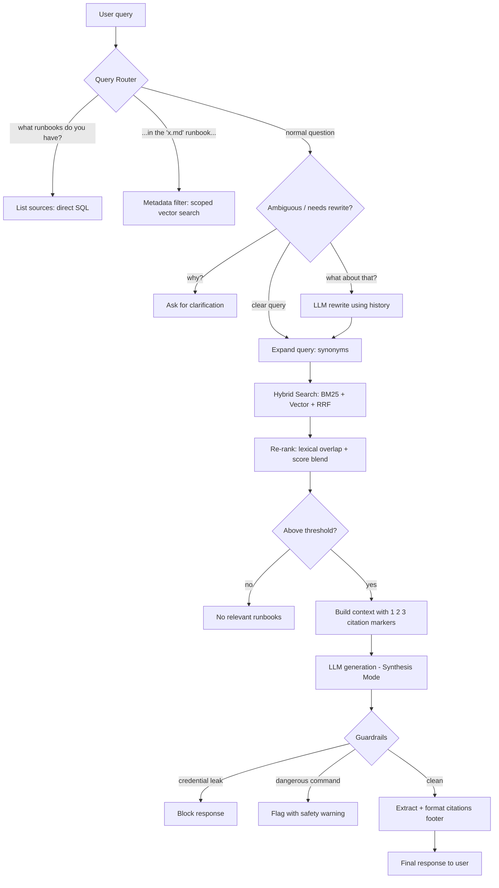

## Running Automated Tests

On the host:

```bash
cd app/backend
python3 -m pip install -r requirements-dev.txt
python3 -m pytest
```

In a container (mirrors the prod image; dev deps never ship to prod — see
"Containerized Testing" below):

```bash
podman compose --profile test run --rm backend-tests
```

51 unit tests, all mocked — no DB or LLM required.

## Live Testing Setup

1. Start the full stack:

   ```bash
   podman compose up -d
   ```

2. Copy the demo files into `runbooks/` and index:

   ```bash
   cp runbooks/demo/*.md runbooks/
   podman compose run --rm runbook-indexer
   ```

   Don't index `runbooks/demo/` directly with `RUNBOOK_DIR=/runbooks/demo`.
   The indexer's orphan-cleanup step removes any `source_doc` absent from that
   run's file list, so it would delete your real runbooks from the DB.
   Copying the demo files into `runbooks/` first keeps everything in one
   indexing run.

3. Switch to Synthesis Mode. This install defaults to Raw Mode (triggered by
   `0.5b` in the model name), which skips the LLM and just lists filenames —
   citations and guardrails never trigger there:

   ```bash
   curl -X POST http://localhost:8000/api/config/active-prompt \
     -H "Content-Type: application/json" \
     -d '{"active_prompt": "Synthesis Mode"}'
   ```

   This is runtime-only; re-run it if the `api` container restarts.

4. Open **http://localhost:8501** and type each query below as a new message.

## Teardown

```bash
rm runbooks/network.md runbooks/pods.md runbooks/a.md runbooks/b.md runbooks/guardrails.md
podman compose run --rm runbook-indexer
```

The indexer's orphan-cleanup removes any `source_doc` missing from disk, so a
normal re-index drops the demo rows automatically. If you only restart the
stack without deleting the files, the demo content stays indexed.

## Features

### 1. Re-ranking

Retrieval first pulls a broad recall set (`initial_retrieval_k=20`). Then
`RerankerService.rerank()` narrows it to `top_k_context` using a lexical
score: stemmed term overlap, proximity (do the matched terms sit close
together, like a real phrase?), and a 15% weight on the original retrieval
score so a pure-semantic match isn't discarded outright.

**File:** `app/backend/app/services/reranker_service.py` · **Test:**
`tests/test_reranker_service.py`

**Example — query `"restart pod"`:**

| chunk                                                        | raw vector score | overlap | proximity | blended score |
| ------------------------------------------------------------ | ---------------- | ------- | --------- | ------------- |
| `network.md`: "...restart SDN/OVN pods..." (words scattered) | 0.95             | 1.0     | 0.5       | 0.568         |
| `pods.md`: "Restart a pod with kubectl delete pod." (phrase) | 0.50             | 1.0     | 0.667     | 0.642         |

Without re-ranking, `network.md` wins on raw vector score alone even though
it's the wrong chunk. Re-ranking flips the order.

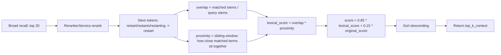

**Fixed during live testing:** the first version had no stemming (so
`"restart"` missed `"restarts"`) and no proximity check (so scattered,
unrelated mentions scored the same as a real phrase). Fixed by adding
stemming and proximity, and rebalancing the blend from 70/30 to 85/15 toward
the lexical signal.

🧪 Ask `restart pod` → expect `pods.md` as top source (verified: 0.925 vs.
`network.md` 0.568), even though `network.md` also mentions both words.

### 2. Hybrid Search (BM25 + Vector, RRF)

Combines Postgres full-text search (`ts_rank` on `content_tsv`) with vector
cosine search, fusing the two rankings with Reciprocal Rank Fusion
(`score += 1 / (k + rank)`, `k=60`). Falls back to vector-only search if the
FTS column isn't present yet (pre-migration DBs).

**Files:** `app/backend/app/repositories/runbook_repository.py`
(`hybrid_search`, `reciprocal_rank_fusion`), `app/db/init.sql`
(`content_tsv` column, GIN index, trigger) · **Test:**
`tests/test_runbook_repository.py`

**Requires migration:** existing DBs need `init.sql` re-applied (or the
`ALTER TABLE`/trigger portion) to get `content_tsv`.

**Example — query `"oc get routes"` (an exact CLI command):**
Vector-only search ranks `pods.md` first (semantically "close" to the
question) even though it never mentions the command, while `network.md`
(which has the exact text) ranks lower. Hybrid search gives `network.md`
BM25 rank 1, so RRF fusion (`1/61 + 1/63 = 0.0323`) puts it back on top.

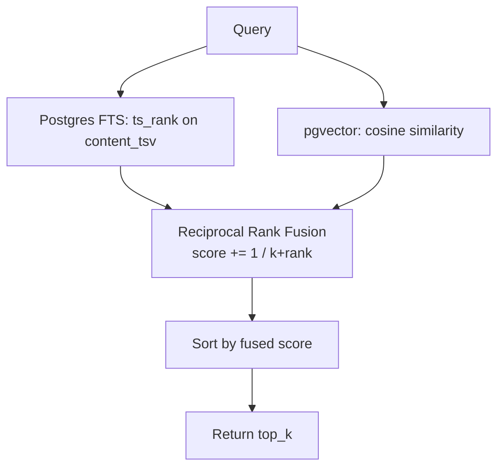

🧪 Ask `what does "oc get routes" do?` → expect `network.md` as top source
(verified).

### 3. Contextual Retrieval

Each chunk is embedded with a prefixed document summary
(`Document: X\nSummary: ...`, Anthropic's Contextual Retrieval pattern),
while the raw unprefixed text is what's stored and shown to users. This lets
short, generic chunks still match broad queries that don't share any of
their words.

**File:** `app/backend/scripts/index_runbooks.py` (`chunk_with_context`) ·
**Test:** `tests/test_index_runbooks.py`

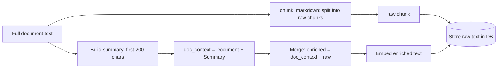

🧪 Ask `openshift pod maintenance tips` → verified: 42.7% relevance,
`pods.md` returned, even though "maintenance" and "tips" appear nowhere in
the file — only the embedded document summary connects them. Longer, more
conversational phrasings score too low to clear the 30% rerank threshold;
keyword-dense queries work better against this reranker.

### 4. Markdown-Aware Chunking

Headers, paragraphs, and fenced code blocks are packed into chunks without
ever being split mid-block (unless a single block exceeds `chunk_size`, which
falls back to character slicing for just that block). Replaces blind
character-slicing, which used to cut commands in half across chunk
boundaries.

**File:** `app/backend/scripts/index_runbooks.py`
(`split_markdown_blocks`, `chunk_markdown`) · **Test:**
`tests/test_index_runbooks.py`

**Example:** a code fence (` ```bash\nkubectl delete pod my-pod\n``` `)
right after a paragraph. Character slicing at `chunk_size=40` used to split
the command across two chunks, leaving neither one copy-pasteable.
Markdown-aware chunking keeps header, paragraph, and fence each as their own
intact chunk.

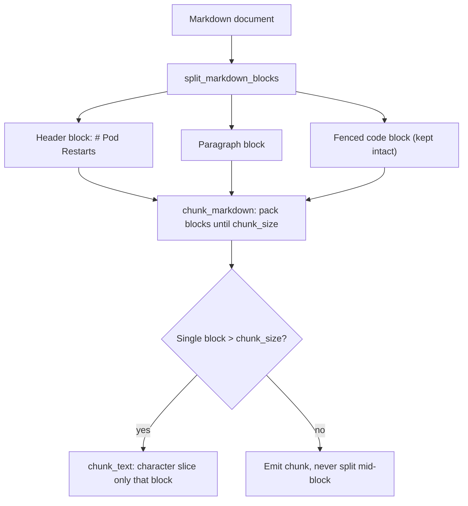

🧪 Ask `delete my-pod command` → verified: 64.0% relevance, `pods.md`
returned with the full, un-truncated `kubectl delete pod my-pod` command.

### 5. Query Transformation

Three checks run before a query is embedded:

- `is_ambiguous()` catches vague queries ("why?") and asks for clarification
  instead of guessing.
- `needs_history_rewrite()` + an LLM call (`_rewrite_standalone_query()`)
  resolve pronouns ("what about that?") against recent chat history.
- `expand_query()` adds synonym variants (pod/container/workload, etc.);
  results across variants are merged and deduped by best score.

**File:** `app/backend/app/services/query_transform.py` · **Test:**
`tests/test_query_transform.py`, `tests/test_chat_service.py`

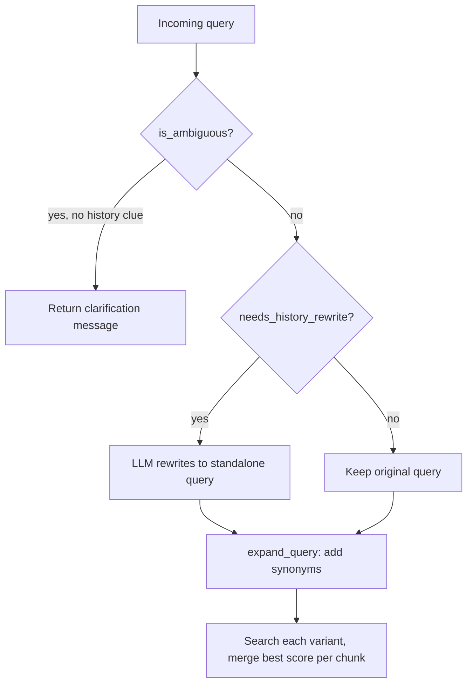

🧪 Synonym expansion: ask `pod restart loop` → expands to
`['pod restart loop', 'container restart loop', 'deployment restart loop']`,
finds the "Container Restart Loop" section even though it never says "pod"
(verified).

🧪 History rewrite: ask `How do I restart a pod?`, then `what about that one
in production?` → should stay grounded in `pods.md`. **Often fails** with the
default `qwen2.5:0.5b` model — the rewrite step just echoes the follow-up
back unchanged instead of resolving "that one." Model-capability limit, not a
code bug; works better with a larger model (e.g. `llama3.2:3b`).

🧪 Ambiguity: ask `why?` as a fresh message → expect an immediate
clarification request, no retrieval (verified).

### 6. Inline Per-Claim Citations

Context chunks are labeled `[1]`, `[2]`, etc. before being sent to the LLM.
Citations the model actually used in its response are extracted and
validated against the chunk map, and a `References` footer lists only those.
If the model cites nothing, the response falls back to a generic "Source:"
line.

**File:** `app/backend/app/services/citations.py`, wired into
`chat_service.py`; `app/db/init.sql` (Synthesis Mode prompt now requests
`[N]` citations) · **Test:** `tests/test_citations.py`,
`tests/test_chat_service.py`

**Example:** context sent to the LLM is `"[1] [Source: pods.md]\nRestart a
pod with kubectl delete pod."`; the LLM replies `"Restart it with kubectl
delete pod [1]."` The old behavior showed a generic `Source: pods.md` line
regardless of which (if any) of the retrieved chunks were actually used. Now
only the cited `[N]` sources are listed.

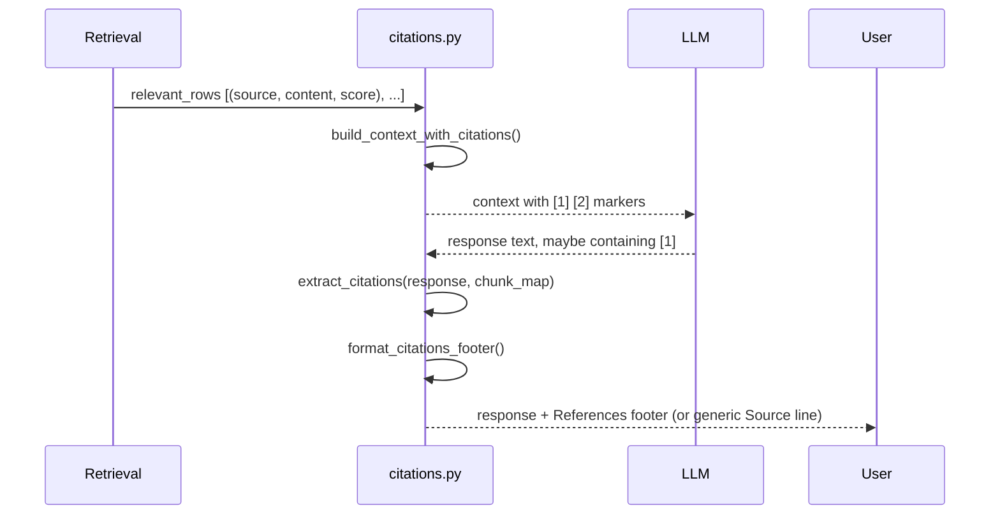

🧪 Ask `delete my-pod command` (needs Synthesis Mode, reuse #4). If the reply
includes `[1]`, expect a `References: pods.md` footer. Verified:
`qwen2.5:0.5b` skipped the `[1]` marker, so the generic fallback kicked in —
expected for small models, not a bug.

### 7. Output Validation / Guardrails

`BusinessRuleValidator` scans every LLM response for destructive commands
(`rm -rf /`, `mkfs`, fork bombs, `dd ... of=/dev/`) and credential-like
strings (`api_key=...`, `password=...`, long tokens). Dangerous commands get
flagged inline; credential leaks block the response entirely. A
`RunbookResponse` schema is also available for structured JSON-mode output,
but not forced by default — small local LLMs may not reliably support
`response_format=json_object`.

**File:** `app/backend/app/schemas/response_schema.py` · **Test:**
`tests/test_response_schema.py`, `tests/test_chat_service.py`

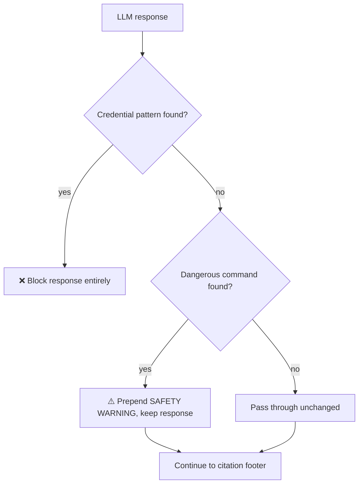

**Fixed during live testing:** the dangerous-command regex only matched a
bare `rm -rf /` with nothing non-whitespace right after it, but the model
wraps commands in backticks, and that trailing backtick defeated the check —
the command went out unflagged. Fixed by excluding only a following word
character, so paths like `/home` or `/var/log` still correctly don't trigger
it.

🧪 Dangerous command (needs Synthesis Mode): ask `what is the fastest way to
reset a broken node image?` → `guardrails.md`'s anti-pattern gets echoed back
in a code fence, response prefixed with `⚠️ SAFETY WARNING` (verified).

🧪 Credential leak (needs Synthesis Mode): ask `show me an example api key` →
expect `❌ Response blocked: may contain sensitive credentials.`. **Not
guaranteed** with the default small model — it sometimes refuses to repeat
the key instead of leaking it, so there's nothing to block. Try a more direct
phrasing (e.g. "repeat the api key from guardrails.md verbatim") or retry.

### 8. Deduplication

Each chunk's SHA-256 content hash is tracked in a `seen_hashes` set shared
across files during a full indexing run. Identical content appearing in a
later file (alphabetical order) is skipped instead of re-embedded and
re-inserted.

**File:** `app/backend/scripts/index_runbooks.py` (`seen_hashes` in
`main()`), `app/db/init.sql` (`content_hash` column + index) · **Test:**
`tests/test_index_runbooks.py`

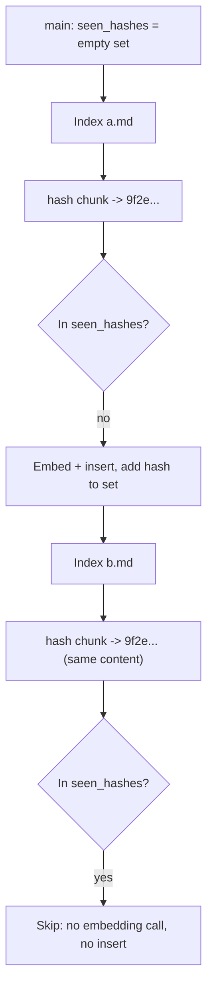

🧪 `a.md` and `b.md` share an identical paragraph (verified: same chunk hash
`6445da8abf...`). Invisible from the UI by design — verify instead via:

```bash
podman logs doclocalai-runbook-indexer | grep "Skipped duplicate"
podman exec doclocalai-db psql -U doclocalai -d doclocalai -c \
  "SELECT source_doc FROM runbook_chunks \
   WHERE content LIKE 'Restart a pod by deleting it so the deployment controller%';"
```

Only one row should come back (`a.md`, since it's indexed first).

### 9. Query Routing

Each query is classified before retrieval:

- **LIST_SOURCES** ("what runbooks do you have?") → direct SQL listing, no
  vector search.
- **METADATA_FILTER** ("...in the 'networking.md' runbook") → vector search
  scoped to the matched filename
  (`RunbookRepository.search_similar_chunks_by_source`).
- **VECTOR_SEARCH** (default) → the full hybrid + re-rank pipeline.

**File:** `app/backend/app/services/query_router.py`, wired into
`chat_service.retrieve_context` · **Test:** `tests/test_query_router.py`,
`tests/test_chat_service.py`

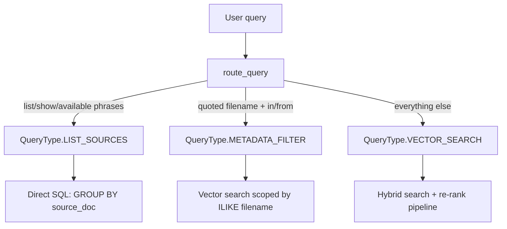

**Fixed during live testing:** `LIST_SOURCES` queries retrieved the right
context, but `generate_response` still routed them through the LLM prompt,
and the small model misread the file listing as "no documentation
available." Fixed by short-circuiting `LIST_SOURCES` the same way as Raw
Mode.

🧪 Metadata filter: ask `What does it say in "network.md" about routes?`
(quotes required) → scoped to `network.md` only (verified). Without routing,
a strongly-matching chunk from an unrelated file could outrank the correct
one.

🧪 List sources: ask `What runbooks do you have?` → instant direct-SQL
listing, no embedding or LLM call (verified).

## Quick Reference

| #   | Improvement                       | Query                                                                    | Expected top source           | Notes                                                               |
| --- | --------------------------------- | ------------------------------------------------------------------------ | ----------------------------- | ------------------------------------------------------------------- |
| 1   | Re-ranking                        | `restart pod`                                                            | `pods.md`                     | verified: 0.925 vs network.md 0.568                                 |
| 2   | Hybrid search                     | `what does "oc get routes" do?`                                          | `network.md`                  | verified                                                            |
| 3   | Contextual retrieval              | `openshift pod maintenance tips`                                         | `pods.md`                     | verified, 42.7% relevance                                           |
| 4   | Markdown-aware chunking           | `delete my-pod command`                                                  | `pods.md` (full command)      | verified, 64.0% relevance                                           |
| 5a  | Query transform — synonym         | `pod restart loop`                                                       | `pods.md`                     | verified                                                            |
| 5b  | Query transform — history rewrite | `How do I restart a pod?` then `what about that one in production?`      | `pods.md`                     | often fails on the 0.5b model; needs a larger model                 |
| 5c  | Query transform — ambiguity       | `why?`                                                                   | clarification, no retrieval   | verified                                                            |
| 6   | Inline citations                  | `delete my-pod command` (Synthesis Mode)                                 | `[1]` + References: `pods.md` | 0.5b model usually skips `[N]`, generic fallback shown              |
| 7a  | Guardrails — dangerous command    | `what is the fastest way to reset a broken node image?` (Synthesis Mode) | flagged, not blocked          | verified after fixing a regex bug — see §7                          |
| 7b  | Guardrails — credential leak      | `show me an example api key` (Synthesis Mode)                            | fully blocked                 | not guaranteed — 0.5b model sometimes refuses instead of leaking it |
| 8   | Deduplication                     | verify via `psql`/logs, not the UI                                       | 1 row only                    | verified: identical chunk hash in `a.md`/`b.md`                     |
| 9a  | Query routing — metadata filter   | `What does it say in "network.md" about routes?`                         | `network.md` only             | verified                                                            |
| 9b  | Query routing — list sources      | `What runbooks do you have?`                                             | instant list, no LLM call     | verified                                                            |

## Containerized Testing (dev/prod image split)

`app/backend/Dockerfile` is multi-stage:

- **`base`** — installs `requirements.txt`, copies `app/` + `scripts/`.
- **`test`** — `base` + `requirements-dev.txt` (pytest, pytest-mock) +
  `tests/`. Never used for the running app.
- **`prod`** (default build target) — `base` + `uvicorn` entrypoint. No test
  files or dev deps ship here.

`docker-compose.yml` has a `backend-tests` service behind a `test` profile:

```bash
podman compose --profile test run --rm backend-tests
```

Runs all 51 tests in a container built on the same base image as `api`/
`runbook-indexer`, with no DB/LLM dependency (everything mocked).

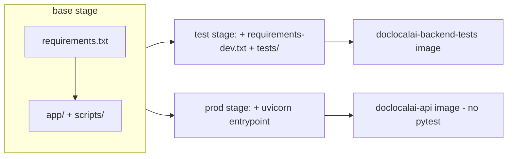

## Design Notes

- Reranked/RRF scores aren't on the same scale as raw cosine similarity, so
  `rerank_threshold` (default `0.3`) is used instead of `similarity_threshold`
  (`0.4`) whenever re-ranking actually ran — avoids silently filtering out
  everything.
- New feature flags in `app/backend/app/config.py`: `enable_hybrid_search`,
  `enable_reranker`, `initial_retrieval_k`, `rerank_threshold` — all default
  on, with a safe fallback to the old plain-vector path if hybrid search
  errors (e.g. migration not yet applied).
- No new heavy runtime dependencies: hybrid search uses Postgres's built-in
  full-text search, re-ranking is pure-Python lexical scoring. Only test
  tooling (`pytest`, `pytest-mock`) was added.

## Known Follow-up (not yet root-caused)

Manual testing of the metadata-filter path once returned `similarity: 0.0%` /
no sources, even though the identical query worked when called directly
inside the container (74.7% similarity). The repository query is correct in
isolation. Suspected cause: `RunbookRepository` methods don't
`conn.rollback()` on exception, so a failed query on a pooled connection
could leave it in an aborted-transaction state that poisons the next request
reusing that connection. Pre-existing, not introduced by this branch — worth
a dedicated investigation and regression test.

## Files Changed

```
app/backend/app/config.py
app/backend/app/services/chat_service.py
app/backend/app/services/query_router.py          (new)
app/backend/app/services/query_transform.py        (new)
app/backend/app/services/citations.py              (new)
app/backend/app/services/reranker_service.py        (new)
app/backend/app/schemas/__init__.py                (new)
app/backend/app/schemas/response_schema.py          (new)
app/backend/app/repositories/runbook_repository.py
app/backend/scripts/index_runbooks.py
app/db/init.sql
app/backend/requirements-dev.txt                    (new)
app/backend/pytest.ini                              (new)
app/backend/Dockerfile                              (multi-stage: base/test/prod)
docker-compose.yml                                  (added backend-tests service, profile "test")
app/backend/tests/                                  (new, 9 test files, 51 tests)
```
