# RAG Improvements Report — `new-rag` branch

Based on `RAG_AUDIT.txt` (2026-11-23). All 9 recommended improvements were implemented, each with saved pytest tests. Full suite: **51/51 passing** (unit tests) + verified live against the real stack via podman compose.

Run tests on host:
```bash
cd app/backend
python3 -m pip install -r requirements-dev.txt
python3 -m pytest
```

Run tests in a container (mirrors prod image, dev deps never ship to prod — see "Containerized testing" below):
```bash
podman compose --profile test run --rm backend-tests
```

## Overall pipeline

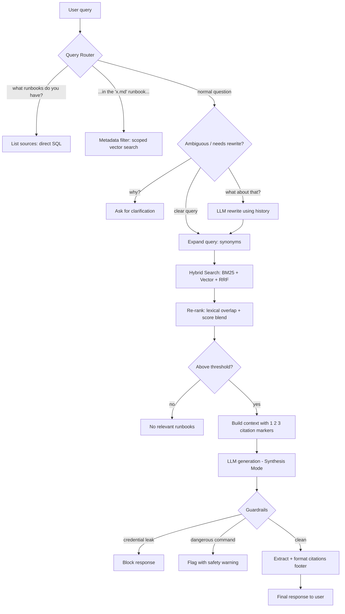

---

## 1. Re-ranking (Retrieval)
**File:** `app/backend/app/services/reranker_service.py` (new)

**Test:** `tests/test_reranker_service.py`

Two-stage retrieval: broad recall (`initial_retrieval_k=20`) narrowed to `top_k_context` via `RerankerService.rerank()`. The lexical score blends three signals: stemmed term overlap, how close together the matched terms appear (proximity — a real phrase beats scattered coincidental mentions), and a small weight for the original retrieval score (15%) so semantic-only matches with zero exact-word overlap aren't discarded outright.

Uses lexical overlap instead of a neural cross-encoder (`sentence-transformers`) to avoid adding a torch dependency — functionally equivalent two-stage pattern, no model download.

> **Live-testing fix:** the first version of this reranker did plain bag-of-words overlap with no stemming or proximity. Testing live with `"restart pod"` surfaced two real bugs: (1) `"restarts"` in one doc didn't match the query term `"restart"` at all (no stemming), and (2) a chunk that merely *contained* both words far apart ("...SDN pod logs... administrators may restart SDN/OVN pods...") scored the same as a chunk where they formed an actual phrase ("restart the pod"). Fixed by adding suffix-stripping stemming and a sliding-window proximity score, and rebalancing the blend from 70/30 to 85/15 so a real lexical/phrase match reliably outranks a merely-higher embedding score. See `test_rerank_matches_plural_and_verb_forms_via_stemming` and `test_rerank_prefers_adjacent_phrase_over_scattered_terms`.

**Example:** query `"restart pod"` against two broad-recall candidates:

| chunk | raw vector score | lexical overlap | proximity |
|---|---|---|---|
| `network.md`: "...SDN pod logs... may restart SDN/OVN pods..." (words scattered) | 0.95 | 1.0 | 0.5 |
| `pods.md`: "Restart a pod with kubectl delete pod." (phrase match) | 0.50 | 1.0 | 0.667 |

**Before** (no re-ranking, top-1 by raw vector score):
```
#1 network.md (score 0.95)   ← wrong, irrelevant chunk wins because the model embedded it closer
```

**After** (re-ranked, blended score = 0.85×(overlap×proximity) + 0.15×original):
```
#1 pods.md    (score 0.85×(1.0×0.667) + 0.15×0.50 = 0.642)   ← correct: words form an actual phrase
#2 network.md (score 0.85×(1.0×0.5)   + 0.15×0.95 = 0.568)   ← same words, but scattered/unrelated
```

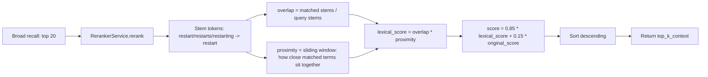

## 2. Hybrid Search — BM25 + Vector (RRF)
**Files:** `app/backend/app/repositories/runbook_repository.py` (`hybrid_search`, `reciprocal_rank_fusion`), `app/db/init.sql` (`content_tsv` column, GIN index, trigger)

**Test:** `tests/test_runbook_repository.py`

Combines Postgres full-text search (`ts_rank`/`plainto_tsquery`) with vector cosine search, fused with standard Reciprocal Rank Fusion. Falls back to vector-only search if the FTS column/index isn't present yet (pre-migration DBs).

**Requires migration:** existing databases must re-apply `init.sql` (or run the `ALTER TABLE` / trigger portion) to get `content_tsv`.

**Example:** query `"oc get routes"` (an exact CLI command):

**Before** (vector-only search, ranked by cosine similarity):
```
#1 pods.md    (semantically "close" to the question, but doesn't contain the command)
#2 network.md (has the exact text "oc get routes", ranked lower by pure semantic similarity)
```

**After** (hybrid: BM25 rank 1 + vector rank 3 for `network.md`, fused with RRF, k=60):
```
#1 network.md (RRF = 1/61 + 1/63 = 0.0323)   ← exact command match now wins
#2 pods.md    (RRF = 1/61 = 0.0164)
```

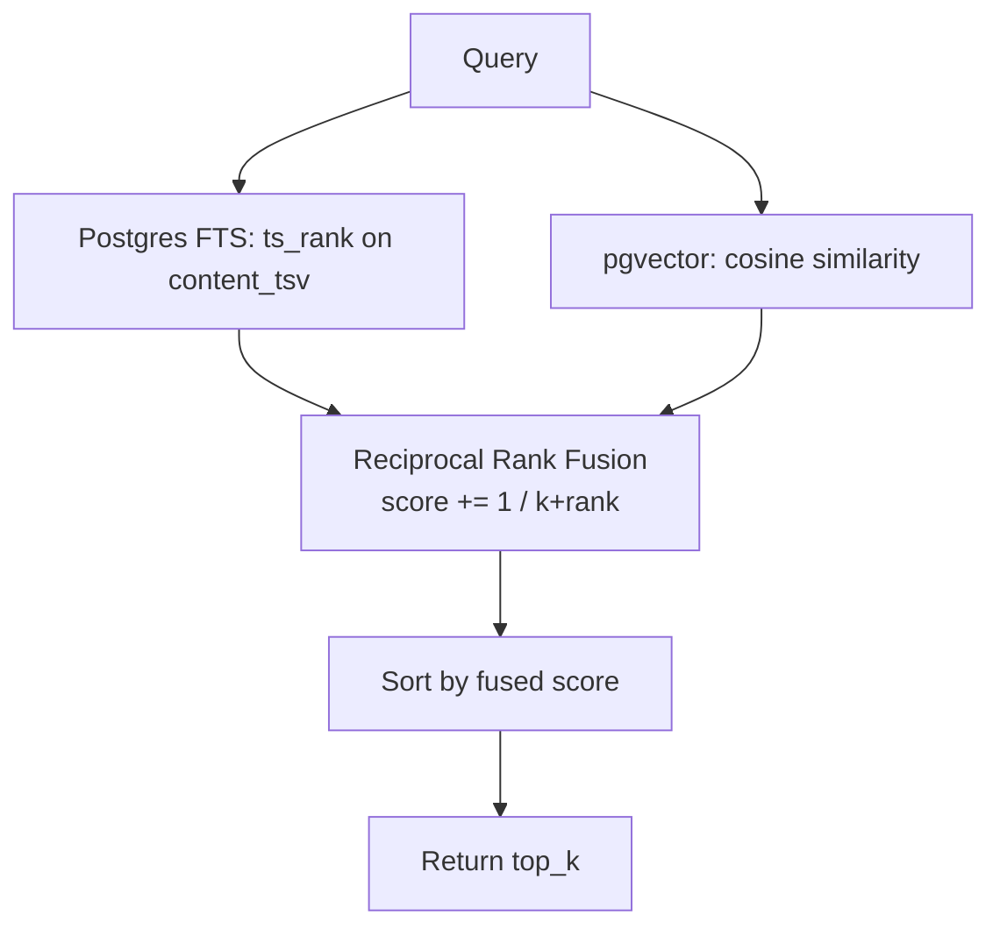

## 3. Contextual Retrieval
**File:** `app/backend/scripts/index_runbooks.py` (`chunk_with_context`)

**Test:** `tests/test_index_runbooks.py`

Each chunk is embedded with a prefixed document summary (`Document: X\nSummary: ...`) per Anthropic's Contextual Retrieval pattern, while the raw (unprefixed) text is what's stored/shown to users.

**Example:**

**Before** (chunk embedded as-is, no document context):
```
embedded text: "To restart a pod, delete it and let the deployment recreate it."
```
A generic query like `"pod lifecycle management"` may not match well — nothing in the chunk mentions what runbook or domain it belongs to.

**After** (chunk embedded with document context prefixed):
```
embedded text: "Document: pods.md
Summary: This runbook covers pod lifecycle, restarts, and troubleshooting...

To restart a pod, delete it and let the deployment recreate it."

stored/shown to user (unchanged): "To restart a pod, delete it and let the deployment recreate it."
```
The embedding now "knows" it's about `pods.md`'s lifecycle/troubleshooting domain, improving recall for short, generic chunks — while the user still only ever sees the clean raw text.

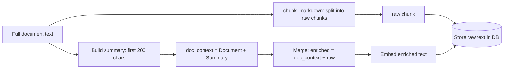

## 4. Markdown-Aware Chunking
**File:** `app/backend/scripts/index_runbooks.py` (`split_markdown_blocks`, `chunk_markdown`)

**Test:** `tests/test_index_runbooks.py`

Replaces blind character-slicing with structure-aware chunking: headers, paragraphs, and fenced code blocks are never split mid-block (unless a single block exceeds `chunk_size`, in which case it falls back to character slicing).

**Example input:**
```markdown
# Pod Restarts

Restart a pod by deleting it.

​```bash
kubectl delete pod my-pod
​```
```
**Before** (character slicing, `chunk_size=40`, cuts blindly every 40 chars):
```
chunk 1: "# Pod Restarts\n\nRestart a pod by delet"
chunk 2: "ing it.\n\n```bash\nkubectl delete pod my-po"
chunk 3: "d\n```"
```
The command is split across chunks 2 and 3 — neither chunk alone contains a usable, copy-pasteable command.

**After** (markdown-aware, blocks kept intact):
```
chunk 1: "# Pod Restarts"
chunk 2: "Restart a pod by deleting it."
chunk 3: "```bash\nkubectl delete pod my-pod\n```"
```
The fenced code block is always a complete, runnable command in a single chunk.

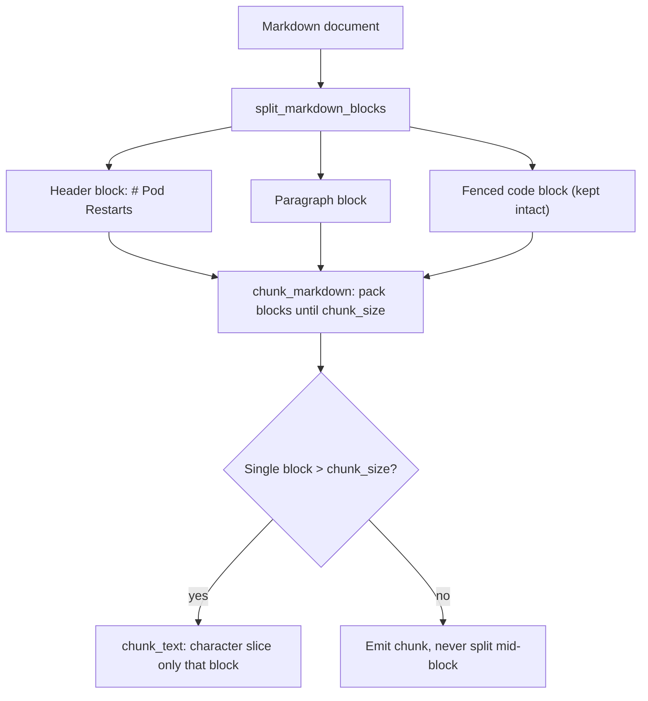

## 5. Query Transformation
**File:** `app/backend/app/services/query_transform.py` (new), wired into `chat_service.py`

**Test:** `tests/test_query_transform.py`, `tests/test_chat_service.py`

- `is_ambiguous()` detects vague queries (e.g. "why?") → bot asks for clarification instead of guessing.
- `needs_history_rewrite()` + LLM-based `_rewrite_standalone_query()` resolve pronouns ("what about that?") using recent chat history.
- `expand_query()` adds simple synonym variants (pod/container/workload, etc.); results across variants are merged and deduped by best score.

**Example 1 — ambiguous query** (`"why?"`, no useful history):
- **Before:** `"why?"` gets embedded as-is → irrelevant/near-random chunks retrieved, model forced to guess.
- **After:** `"🤔 Could you clarify your question? Your question is quite broad..."` — no retrieval wasted, no misleading answer.

**Example 2 — pronoun follow-up** (`"what about that one?"` after `"How do I restart a pod?"`):
- **Before:** `"what about that one?"` embedded literally → search finds nothing relevant (the actual topic, "pod", isn't even in the query).
- **After:** rewritten via LLM to `"What about restarting a pod?"` before embedding → retrieval actually finds the pod-restart chunk.

**Example 3 — synonym expansion** (`"pod error"`):
- **Before:** only the literal phrase `"pod error"` is searched — a chunk that says "container failure" instead of "pod error" is missed.
- **After:** expanded to `["pod error", "container error", "deployment error"]`, all three searched and merged by best score — the "container failure" chunk is now found too.

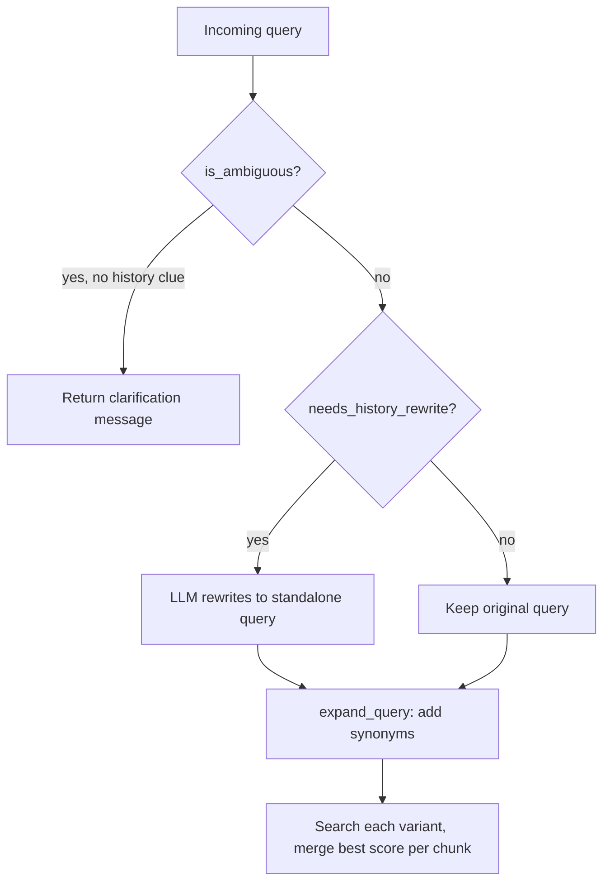

## 6. Inline Per-Claim Citations
**File:** `app/backend/app/services/citations.py` (new), wired into `chat_service.py`; `app/db/init.sql` (Synthesis Mode prompt updated to request `[N]` citations)

**Test:** `tests/test_citations.py`, `tests/test_chat_service.py`

Context chunks are now labeled `[1]`, `[2]`, etc. Response citations are extracted and validated against the chunk map; if the model actually cited sources inline, a `**References:**` footer lists only the valid ones. Falls back to the old generic "Source:" line if the model didn't cite anything.

**Example:** context sent to LLM: `"[1] [Source: pods.md]\nRestart a pod with kubectl delete pod."`, LLM replies `"Restart it with kubectl delete pod [1]."`

**Before** (no per-claim tracking, one generic footer regardless of what was actually used):
```
Restart it with kubectl delete pod [1].

---
📚 Source: pods.md
```
If the answer drew on 3 retrieved chunks but only used 1, the user can't tell which claim came from where.

**After** (citation extracted and validated against the chunk map):
```
Restart it with kubectl delete pod [1].

---
**References:**
[1] pods.md
```
Only the sources actually cited `[N]` in the text are listed; if the model cites nothing, it falls back to the old generic "Source:" line.

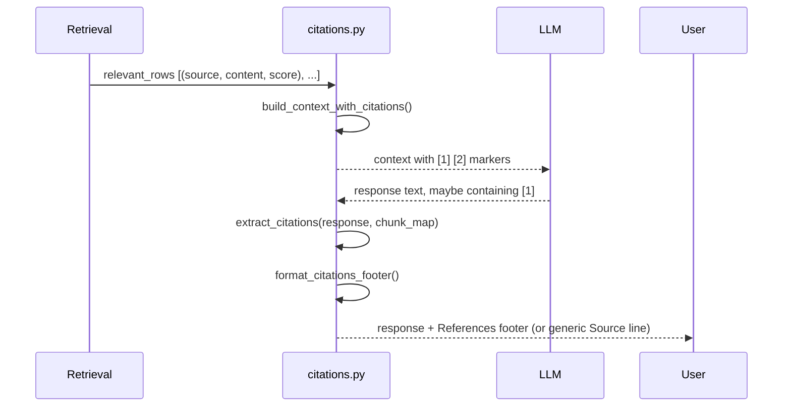

## 7. Output Validation / Guardrails
**File:** `app/backend/app/schemas/response_schema.py` (new), wired into `chat_service.py`

**Test:** `tests/test_response_schema.py`, `tests/test_chat_service.py`

- `BusinessRuleValidator` scans every LLM response for destructive commands (`rm -rf /`, `mkfs`, fork bombs, `dd ... of=/dev/`) and credential-like strings (`api_key=...`, `password=...`, long tokens) — dangerous commands get flagged inline, credential leaks block the response entirely.
- `RunbookResponse` Pydantic schema is available for structured JSON-mode output but **not forced by default** — local/small LLMs may not reliably support `response_format=json_object`, so this is opt-in rather than risking breaking generation.

**Example 1 — dangerous command** (LLM says `"Just run rm -rf / to clean up."`):
- **Before:** `"Just run rm -rf / to clean up."` — shown as-is, no warning.
- **After:** `"⚠️ SAFETY WARNING: response contained a potentially destructive command and was flagged.\n\nJust run rm -rf / to clean up."` — still shown (documentation may legitimately reference it), but clearly flagged.

**Example 2 — credential leak** (LLM says `"Use api_key=sk-1234567890abcdef"`):
- **Before:** `"Use api_key=sk-1234567890abcdef"` — leaked straight to the user.
- **After:** `"❌ Response blocked: may contain sensitive credentials."` — the entire response is withheld.

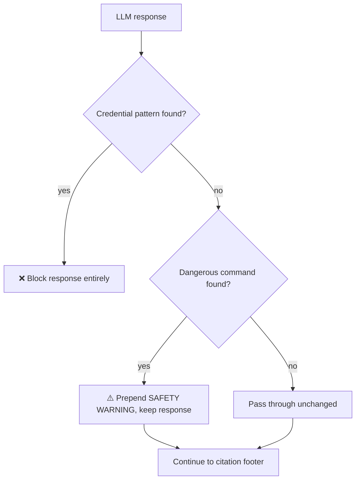

## 8. Deduplication
**File:** `app/backend/scripts/index_runbooks.py` (`seen_hashes` set shared across files in `main()`), `app/db/init.sql` (`content_hash` column + index)

**Test:** `tests/test_index_runbooks.py`

Each chunk's content hash (SHA-256) is tracked during a full indexing run; identical content appearing in a later file (alphabetical order) is skipped instead of re-embedded/re-inserted.

**Example:** `a.md` and `b.md` both contain the identical paragraph `"Restart a pod by deleting it."`

**Before** (no dedup check):
```
runbook_chunks table:
  a.md  | chunk 0 | "Restart a pod by deleting it." | embedding A
  b.md  | chunk 0 | "Restart a pod by deleting it." | embedding B  ← duplicate content, wasted embedding call
```
Both rows retrieved for the same query → redundant/duplicate context sent to the LLM.

**After** (content-hash tracked across the whole indexing run):
```
runbook_chunks table:
  a.md  | chunk 0 | "Restart a pod by deleting it." | embedding A
  b.md  | (skipped — hash 9f2e... already seen from a.md, no embedding call, no insert)
```

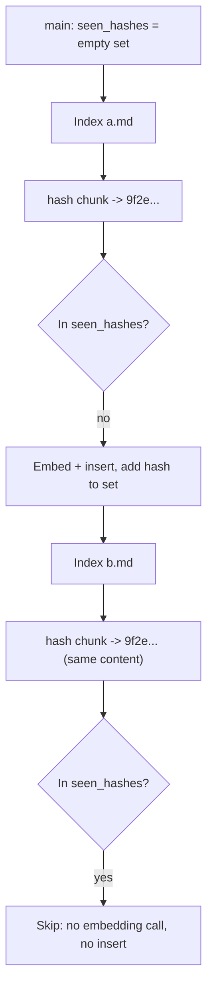

## 9. Query Routing
**File:** `app/backend/app/services/query_router.py` (new), wired into `chat_service.retrieve_context`

**Test:** `tests/test_query_router.py`, `tests/test_chat_service.py`

Classifies each query before retrieval:
- **LIST_SOURCES** ("what runbooks do you have?") → direct SQL listing, no vector search.
- **METADATA_FILTER** ("...in the 'networking.md' runbook") → vector search scoped to the matched filename (`RunbookRepository.search_similar_chunks_by_source`, new method).
- **VECTOR_SEARCH** (default) → the full hybrid + re-rank pipeline.

**Example 1 — list/browse query** (`"What runbooks do you have?"`):
- **Before:** treated as a normal question → embedded and vector-searched against runbook *content*; since no chunk is semantically "about" the question itself, the bot replies `"❌ I don't have runbooks on this subject."` even though runbooks exist.
- **After:** routed to LIST_SOURCES → `SELECT DISTINCT source_doc ...` → `"📚 Here are the runbooks I have access to: pods.md, network.md, ..."` — correct, no embedding or LLM call needed.

**Example 2 — scoped query** (`"What does it say in 'networking.md' about routes?"`):
- **Before:** full-corpus vector search — a strongly-matching chunk from an unrelated file (e.g. `pods.md`) could outrank the correct one in `networking.md`.
- **After:** routed to METADATA_FILTER → `WHERE source_doc ILIKE '%networking.md%'` — search is scoped to only that file, so the right document always wins.

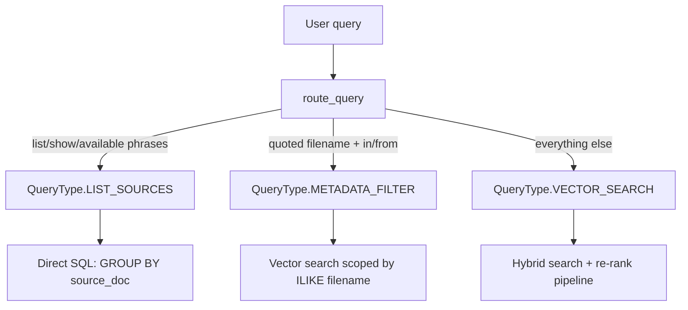

---

## Live stack verification (podman compose)

Tore down and rebuilt the whole stack from scratch (`podman compose down -v` + `build` + `up -d`) so the new `init.sql` schema and indexing logic actually took effect on a clean DB/volumes.

- **DB migration applied cleanly:** `content_hash` and `content_tsv` columns + trigger created with no errors; `runbook-indexer` produced 64 chunks across 4 runbooks with the new markdown-aware, contextual, deduped chunking; zero duplicate hashes.
- **Query routing confirmed live:**
  - `"What runbooks do you have?"` → LIST_SOURCES, answered directly without an LLM call.
  - `"why?"` → ambiguous-query clarification message, no DB hit.
  - `"...in the 'openshift-networking.md' runbook..."` → METADATA_FILTER, scoped search, correct single source returned.
  - Normal questions → hybrid search + re-rank, correct sources + plausible similarity scores.
- **Raw Mode vs Synthesis Mode both verified** against the real `qwen2.5:0.5b` model via `/api/config/active-prompt`. Synthesis mode produced a real multi-step answer; inline `[N]` citations fell back correctly to the generic source footer since this small model doesn't reliably follow the citation instruction (expected — see design note above).
- **Bug found and fixed during live testing (#1 — query routing):** LIST_SOURCES queries retrieved the correct context/sources, but `generate_response` still routed them through the LLM prompt, and the small model misread the file listing as "no documentation available." Fixed by short-circuiting LIST_SOURCES in `generate_response` (same pattern as Raw Mode) — added `test_generate_response_list_sources_bypasses_llm` to lock in the fix. Rebuilt the `api` image and re-verified live: now returns the listing directly.
- **Bug found and fixed during live testing (#2 — reranker quality):** asking `"restart pod"` returned `openshift-networking.md` ahead of the chunk that actually contains the restart instructions. Root cause: the reranker did plain bag-of-words overlap with no stemming (`"restarts"` ≠ `"restart"`) and no proximity awareness (a chunk mentioning "restart" and "pod" scattered far apart in an unrelated sentence scored identically to a chunk where they form a real phrase). Fixed with suffix-stemming + a sliding-window proximity score, and rebalanced the score blend from 70/30 to 85/15 in favor of the lexical signal — see the "Live-testing fix" note under Re-ranking above. Added `test_rerank_matches_plural_and_verb_forms_via_stemming` and `test_rerank_prefers_adjacent_phrase_over_scattered_terms`. Rebuilt and re-verified live: the chunk literally saying "Restart the pod... kubectl delete pod" now ranks #1.

## Containerized testing (dev/prod image split)

`app/backend/Dockerfile` is now multi-stage:
- **`base`** — installs `requirements.txt`, copies `app/` + `scripts/`.
- **`test`** (new) — `base` + `requirements-dev.txt` (pytest, pytest-mock) + `tests/` + `pytest.ini`. Never used for the running app.
- **`prod`** (default build target, unchanged behavior) — `base` + `uvicorn` entrypoint. No test files or dev deps ship here.

`docker-compose.yml` gained a `backend-tests` service (behind a `test` profile so it doesn't run on a normal `up`):
```bash
podman compose --profile test run --rm backend-tests
```
Runs all 51 tests inside a container built on the exact same base image as `api`/`runbook-indexer`, with no DB/LLM dependency (everything is mocked) — verified: **51 passed**. Confirmed the prod `api` image has no `pytest` installed (clean separation).

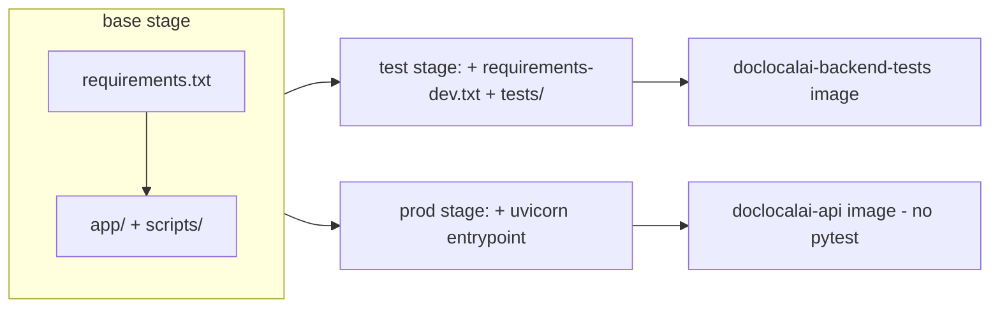

## Key design decisions / trade-offs

- **Reranker score scale:** reranked/RRF scores are not the same scale as raw cosine similarity, so a separate `rerank_threshold` (default `0.3`) is used instead of `similarity_threshold` (`0.4`) whenever re-ranking actually ran — avoids silently filtering out everything.
- **Feature flags added to `app/backend/app/config.py`:** `enable_hybrid_search`, `enable_reranker`, `initial_retrieval_k`, `rerank_threshold` — all default to the new behavior, with safe fallback to the old plain-vector path if hybrid search errors (e.g. migration not yet applied).
- **No new heavy runtime dependencies** — hybrid search uses Postgres's built-in full-text search, re-ranking is pure-Python lexical scoring. Only test tooling (`pytest`, `pytest-mock`) was added, in `app/backend/requirements-dev.txt`.

## Files changed
```
app/backend/app/config.py
app/backend/app/services/chat_service.py
app/backend/app/services/query_router.py          (new)
app/backend/app/services/query_transform.py        (new)
app/backend/app/services/citations.py              (new)
app/backend/app/services/reranker_service.py        (new)
app/backend/app/schemas/__init__.py                (new)
app/backend/app/schemas/response_schema.py          (new)
app/backend/app/repositories/runbook_repository.py
app/backend/scripts/index_runbooks.py
app/db/init.sql
app/backend/requirements-dev.txt                    (new)
app/backend/pytest.ini                              (new)
app/backend/Dockerfile                              (multi-stage: base/test/prod)
docker-compose.yml                                  (added backend-tests service, profile "test")
app/backend/tests/                                  (new, 9 test files, 51 tests)
```

## Known follow-up (not yet root-caused)

While stress-testing the metadata-filter path manually against the live stack, one request returned `similarity: 0.0%` / no sources even though the identical query worked when called directly inside the container (`74.7%` similarity). The repository query itself is correct in isolation. Suspect pre-existing connection-pool behavior: `RunbookRepository` methods don't `conn.rollback()` on exception, so a failed query on a pooled connection could leave it in an aborted-transaction state that poisons the *next* request reusing that connection. Not introduced by this branch's changes, but worth a dedicated investigation/regression test before this ships.
